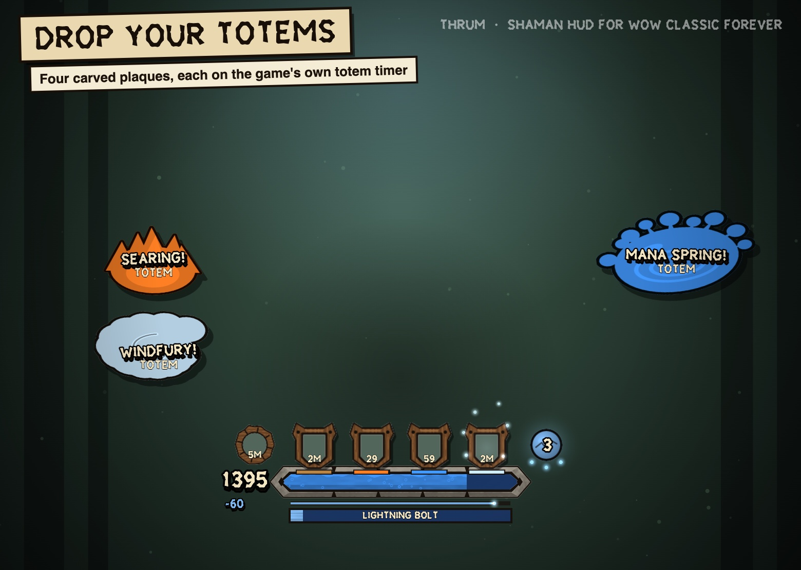
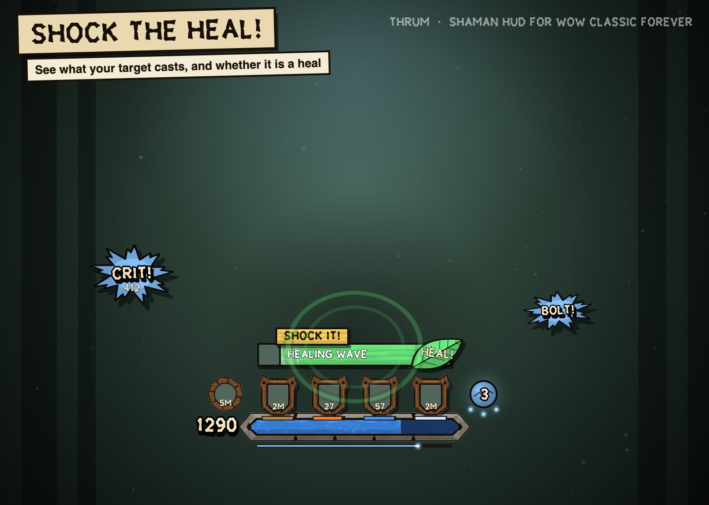
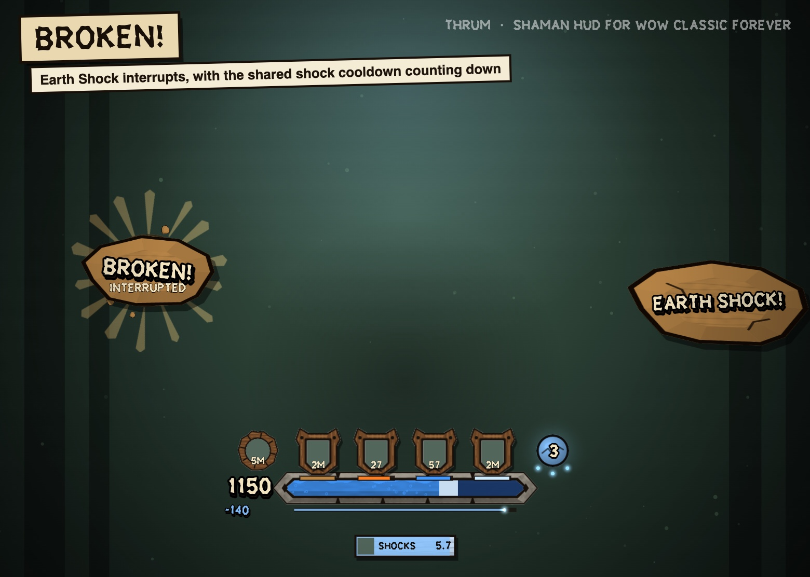
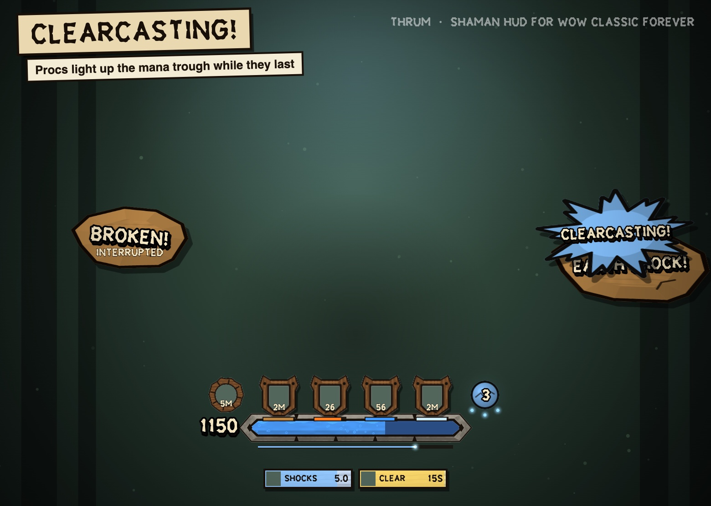
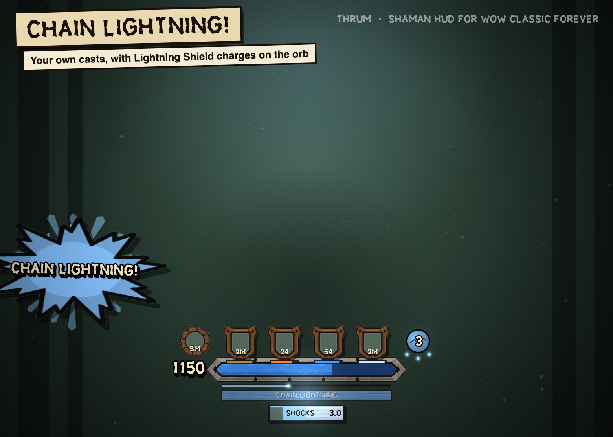
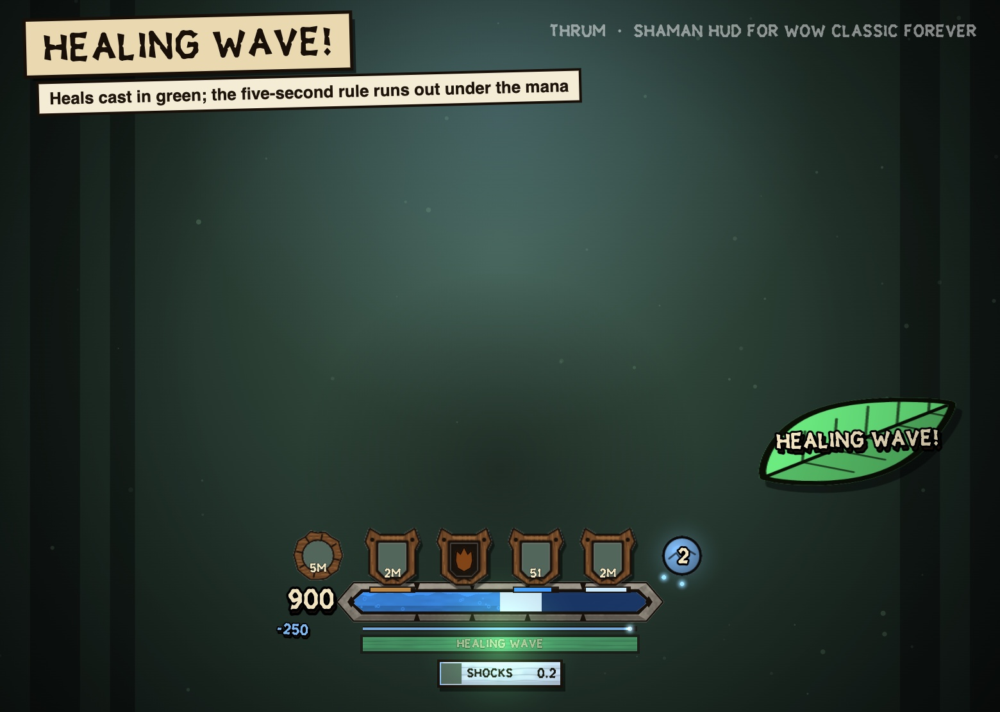
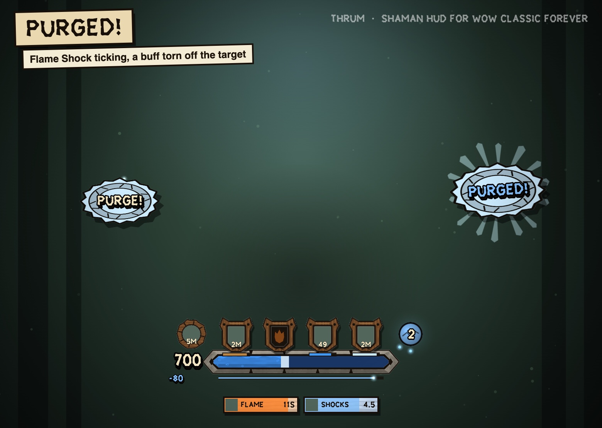

# Thrum

A carved, elemental HUD for shamans in **WoW Classic Forever**. A stone mana trough, a totem
plaque for each element on the game's own timers, and words cut into stone, flame, leaf and
water for everything you cast.

| | |
|---|---|
|  |  |
|  |  |
|  |  |

Rendered from the addon's own layout code (`node tools/test.js --showcase`), not in-game
screenshots; the grey squares in the plaques, boxes and cast bar are where the spells' icons go.

- **Mana**: a stone trough filled with water and a big number. Spent mana lingers as a pale
  chunk before it drains. Regeneration is kept quiet: the number moves in calm steps (about four
  a second) and nothing pops while it fills; only a big gain at once (Mana Tide, a potion) gets a
  ripple. A thin line under the trough runs out over the **five-second rule** after you spend
  mana. Not enough mana shakes the HUD red. Ghost Wolf turns the water pale.
- **Totems**: four carved plaques, one per element (earth, fire, water, air). Casting a totem
  lights its plaque straight away; then the plaque runs on the game's own timer for that slot,
  so the seconds are exact (ranks and talents included) even in combat. The time turns ember
  under 10 seconds and red under 5. A totem killed before its time is up gets a `SMASHED!`;
  replacing one with another does not. This client has no Blizzard totem timers, so these are
  the ones you get.
- **Shocks**: `EARTH SHOCK!`, `FLAME SHOCK!`, `FROST SHOCK!`, and one `SHOCKS` box for their
  shared cooldown (`SHOCK READY` when it is back). Flame Shock's burn and Frost Shock's slow get
  their own boxes on the target, bound to the real debuff.
- **Interrupts**: `SHOCK IT!` while your target casts something you can interrupt. A carved
  cast bar shows the spell's icon and name and fills as the cast goes on; it turns green with a
  `HEAL!` leaf for heals (`BUFF!` for other helpful spells). With the shocks on cooldown it
  suggests `STOMP IT!` (War Stomp) or, for a harmful spell, `GROUND IT!` (Grounding Totem); if
  nothing is ready it stays up, dimmed, counting down (`SHOCK IN 3`). `BROKEN!` when your shock
  breaks the cast.
- **Lightning Shield**: an orb right of the totems with the charges left on it. A charge going
  off gives a small crackle, no words; `SHIELD DOWN` in combat when the last one goes.
- **Weapon imbue**: a carved badge left of the totems with your Rockbiter, Flametongue,
  Frostbrand or Windfury and the minutes left; `IMBUE FADED!` when it runs out.
- **Procs**: `CLEARCASTING!` (the water shimmers while your next spell is free) and `FLURRY!`,
  each with a box while it lasts.
- **Casts and heals**: your own cast in a slim bar under the trough (green for heals, storm blue
  for lightning), and a word for each spell: `BOLT!`, `CHAIN LIGHTNING!`, `HEALING WAVE!`,
  `CHAIN HEAL!`, `PURGE!` then `PURGED!` when it takes a buff, `STORMSTRIKE!`, `MASTERY!`,
  totem names (`SEARING!`, `MANA SPRING!`...) and the imbues. Words pop up small, to the left and
  right and a little above the HUD: never over the middle of the screen or the unit frames.
- **Hits** (solo only): `CRIT!` with the number, `RESISTED!`, `DODGED!`, `IMMUNE!`..., and
  `SLAIN!` when the target drops.
- Hidden out of combat (it appears the moment a fight starts). Turn **Only in combat** off to
  keep it on screen, faded when nothing is going on.

In a group, anything the game cannot pin on you (whose crit, whose kill, whose dispel, an
interrupt with no name on it) is left out rather than guessed.

## Install

Copy the `Thrum` folder into `World of Warcraft/_forever_/Interface/AddOns/` and restart the
game. It only runs on shamans.

## Options

**Options > AddOns > Thrum** has the settings: where the HUD sits (across and up from the
screen's centre, or unlock it and drag), its size, whether it shows only in combat and how faded it
is otherwise, the totem plaques, the imbue badge, the five-second line, the cast bar, the spell words and their size,
procs, `CRIT!`/`RESISTED!`, the `SHOCK IT!` cast bar, and buttons to play the demo or reset the
position. `/thrum options` opens it.

The HUD also joins Blizzard's **Edit Mode** (Esc > Edit Mode): while Edit Mode is open the HUD
shows with a highlight, in or out of combat, and you can drag it into place with the rest of
your UI. Its position is Thrum's own setting, so it is the same in every Edit Mode layout.

## Commands

| | |
|---|---|
| `/thrum test` | play a 15-second pretend fight, to see every effect |
| `/thrum unlock` / `lock` | drag the HUD somewhere else (or drag it in Edit Mode) |
| `/thrum pos 0 -190` | place it exactly: across and up from the centre of the screen |
| `/thrum combat` | toggle showing the HUD only in combat |
| `/thrum scale 1.2` | resize (0.5 – 2.5) |
| `/thrum idle 0.35` | opacity out of combat with nothing happening, when only-in-combat is off |
| `/thrum fx 0.8` | size of the word bursts (0.5 – 1.5) |
| `/thrum words` | toggle the spell words |
| `/thrum hits` | toggle `CRIT!` / `RESISTED!` |
| `/thrum prompt` | toggle `SHOCK IT!` |
| `/thrum procs` | toggle `CLEARCASTING!` / `FLURRY!` |
| `/thrum totems` | toggle the totem plaques |
| `/thrum imbue` | toggle the weapon imbue badge |
| `/thrum castbar` | toggle your cast bar |
| `/thrum fsr` | toggle the five-second-rule line |
| `/thrum reset` | default position and size |

## How it reads the game

Classic Forever hides some numbers from addons in combat (they are "secret": an addon may show
them but not compare or calculate with them) and gives addons no combat log. Thrum works with
that rather than around it:

- Mana (and its maximum) go straight to the trough and the number; nothing does maths on them.
  What you spend comes from your own casts and their mana cost, which are never hidden.
- Cooldowns, totems and auras are duration objects from the game (`C_Spell.GetSpellCooldownDuration`,
  `GetTotemDuration`, `C_UnitAuras.GetAuraDuration`) bound to the bars and seconds
  (`StatusBar:SetTimerDuration`, `C_DurationUtil.CreateDurationTextBinding`), so the game draws
  the real time even when the addon cannot read it. Built-in durations are only a first guess
  until the game hands its timer over, and what the game says is remembered per character.
- Which aura your cast created is found by its instance ID (never hidden); Lightning Shield's
  charges come from `C_UnitAuras.GetAuraApplicationDisplayCount`, a string the orb displays.
- Spells are matched by name from your own `UNIT_SPELLCAST_SUCCEEDED`, so every rank and
  Forever's own spell versions work.
- Procs are found when the game lets addons see that buff. In combat it may not; Clearcasting
  is then still spotted by Lightning Bolt costing no mana, but Flurry can be missed.

Every API is checked against the Blizzard API documentation of the build the game runs.

## Credits

Lettering is **Thrum Runes**, a carved, runic-styled typeface drawn for this addon by
`tools/gen_font.py`, released under the SIL Open Font License (`Thrum/Fonts/OFL.txt`). If the
font cannot be loaded, the game's damage-number font is used instead. All textures are drawn by
`tools/gen_art.py`.

Thrum is built on the architecture of Kapow, a comic-style rogue HUD.

## Development

- `python3 tools/gen_art.py [preview_dir]` redraws the textures in `Thrum/Art` (pure Python);
  with a folder it also writes contact sheets.
- `python3 tools/gen_font.py` rebuilds `Thrum/Fonts/ThrumRunes.ttf` (pure Python).
- `python3 tools/fetch_docs.py` copies Blizzard's generated API docs out of the local Classic
  Forever install into `tools/forever_docs` (not committed). It reads the game files with
  Chronicle's CASC reader (`../chronicle/tools/casc.py`, or pass `--casc`).
- `node tools/test.js` runs the addon's Lua against a mock of the game built from those docs
  (falling back to Chronicle's copy): it checks that every widget method, global and event the
  addon uses exists in the client and accepts what it is given, then plays a fight with
  everything readable and again with mana, auras, cooldowns and totems secret, a grouped fight,
  enemy casts, mana regeneration, hiding out of combat and Edit Mode, every slash command and
  the options page, and asserts what
  should show. It needs `fengari-web.js` (default `../chronicle/emulator/vendor`; `--fengari`
  to override). `--snap out.html` also paints what the HUD looks like at moments of the demo.
- The README images: `node tools/test.js --showcase tools/.preview/show/index.html`, then
  `python3 tools/showcase_save.py tools/.preview/show` and open
  `http://localhost:8769/index.html?save`; each image is written to `docs/screens`.

Thrum has only been tested in this mock so far, not in the real game.
